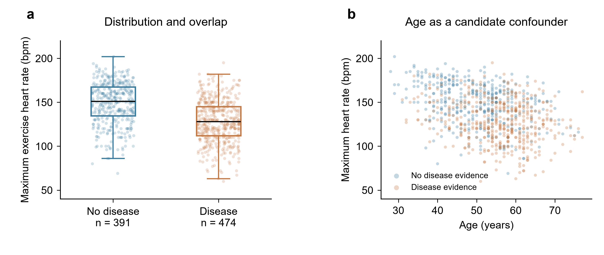
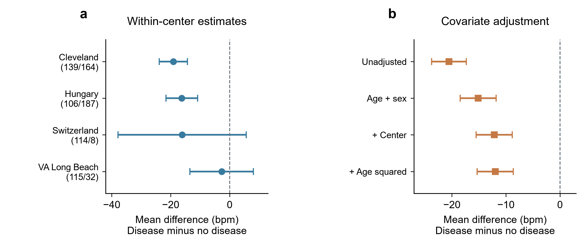
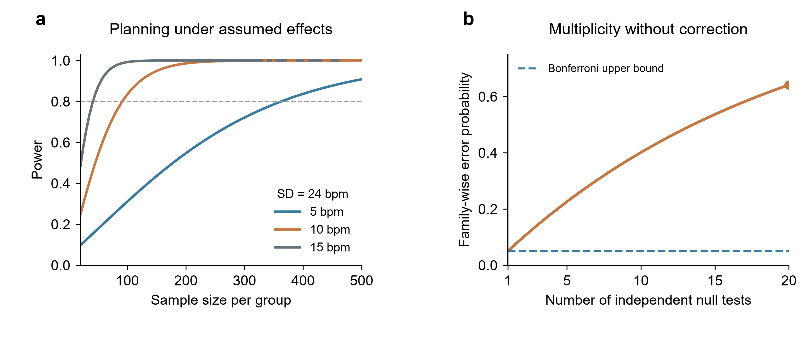

心脏病证据与最大运动心率的关联

## 四中心观察性数据的假设检验与推断边界

Heart disease evidence and maximum exercise heart rate: a four-center observational analysis

课程：AI4BiomedicalDS · 第5讲　　作者 / 学号：________________

## 摘要

心脏病证据是否与最大运动心率的组间差异相关，需要在明确统计假设和推断边界后回答。本文分析课程提供的920条四中心记录，以thalach为唯一主要终点，采用双侧Welch t检验，并探索年龄、性别及中心调整后的关联。865名心率非缺失者进入分析；疾病组474人、无疾病组391人，均值分别为128.26和148.80次/分钟。均值差为−20.54次/分钟（95% CI，−23.73至−17.35；p=1.30×10−33），调整后为−12.17次/分钟。样本支持负向统计关联，但中心构成、缺失及未测量混杂限制了临床与因果解释。

## 引言

“两组均值不同”必须先被转化为明确的研究对象、终点与总体参数。本文围绕课程工作单的问题，比较心脏病证据组与无疾病证据组的最大运动心率，检验是否存在总体均值差，而非证明诊断或治疗有效。

课程资料将每行定义为一名受试者，四个中心是资料来源而非随机处理组。公开Heart Disease资料也描述了四个来源中心[1]；本文实际分析人数以课程CSV为准，不将网站展示的单中心人数套用于合并数据。

## 从科学问题到可检验参数

研究对象为这些中心所代表的受检人群；可直接观察的分析样本为终点完整者。主要解释变量为disease（num>0编码为1），主要终点为thalach，单位次/分钟。分析单位是受试者。

定义Δ=μ₁−μ₀，分别表示疾病组与无疾病组的总体均值之差。H₀：Δ=0；H₁：Δ≠0；α=0.05。采用双侧检验，因为“是否不同”允许任一方向，也避免看到负差异后再改单侧。

图1｜组间分布与年龄结构。a，全部865名终点完整受试者；散点仅作水平抖动，箱体为四分位距，中线为中位数，须为1.5倍四分位距内最远观测值。b，年龄与最大运动心率的原始散点；蓝色为无疾病证据，橙色为疾病证据。点的重叠提示组均值差不等于个体诊断分离。

---

## 结果：组间差异在协变量调整后缩小

原始920人中，疾病组509人、无疾病组411人。排除55条thalach缺失记录后，两组分析人数分别为474和391。无其他因终点数值大小导致的排除；描述统计见表1，原始分布见图1。

| 表1　主要终点的描述统计 | 疾病组 | 无疾病组 |
| --- | --- | --- |
| 终点完整 / 原始人数 | 474 / 509 | 391 / 411 |
| thalach缺失，n（%） | 35（6.88%） | 20（4.87%） |
| 均值 ± 标准差，次/分钟 | 128.26 ± 24.02 | 148.80 ± 23.61 |
| 中位数［四分位数］，次/分钟 | 128［112, 145］ | 151［134.5, 167.5］ |
| 范围，次/分钟 | 60–195 | 69–202 |

## 主要比较

未调整均值差Δ̂为−20.54次/分钟，95%置信区间为［−23.73, −17.35］；Welch t=−12.633，自由度837.18，双侧p=1.30×10−33。按α=0.05拒绝H₀，证据支持两组总体均值不同。原始单位均值差即本题主要效应量。

补充的Mann–Whitney检验得到U=49,781、p=9.03×10−32。其检验对象是分布 / 秩关系，不能把这一p值写成均值差检验或一般意义的中位数差检验。

## 调整与中心差异

探索性线性回归调整年龄、性别后，疾病系数为−15.14次/分钟；加入中心固定效应后为−12.17（95% CI，−15.51至−8.84），较未调整值绝对幅度减小40.7%。这与人群构成影响粗比较的解释相容，但不是混杂已完全消除的证明。

四中心点估计均为负值，但Switzerland及VA Long Beach区间跨零（图2a）；前者无疾病组仅8人。不可将“某中心显著、另一个不显著”解释成已证明中心效应不同。

图2｜中心构成与调整模型。a，中心内未调整均值差及Welch 95% CI；括号人数依次为疾病组 / 无疾病组。b，865人同一分析集上的线性回归疾病系数及HC3稳健95% CI，使用残差自由度的t参考分布；最后一行为再加入年龄平方项。各区间未经多重校正，仅作探索性比较。零线为均值差为零。

---

## 材料与方法

本研究是课程数据的二次分析，未招募新受试者。工作单已指定thalach为主要终点，本文沿用该设定；这不等于真实前瞻性注册。调整模型、分中心分析和年龄非线性分析属于本次补充探索，不追认其为预注册结果。

| 变量 | 类型与编码 | 分析角色 |
| --- | --- | --- |
| thalach | 连续数值，次/分钟 | 唯一主要终点 |
| disease | 二分类：0 / 1 | 主要解释变量；由num&gt;0构建 |
| age | 连续数值，岁 | 候选混杂因素；线性及平方项 |
| sex | 二分类：0=female，1=male | 按原始资料编码的协变量 |
| site | 四水平名义分类 | 来源中心固定效应 |
| record_id / num | 标识符 / 原始有序等级 | 识别记录 / 构建疾病标签 |

## Welch均值比较与区间估计

记各组样本均值、样本方差和人数为ȳg、sg2、ng（g=0,1）。Welch检验不要求两组总体方差相等[2]。计算式如下，tν,0.975表示t分布的97.5%分位数。

$\widehat{\Delta}=\bar{y}_1-\bar{y}_0,\quad SE=\sqrt{s_1^2/n_1+s_0^2/n_0},\quad t=\widehat{\Delta}/SE$

$\nu=\frac{(s_1^2/n_1+s_0^2/n_0)^2}{(s_1^2/n_1)^2/(n_1-1)+(s_0^2/n_0)^2/(n_0-1)}$

$95\%\ \mathrm{CI}=\widehat{\Delta}\ \pm\ t_{\nu,0.975}\,SE$

## 适用条件与备选方法

受试者间独立性是核心假设，不能仅凭样本量大而保证。记录标识唯一；同中心仍可能共享测量流程或转诊结构。连续结局存在明显个体重叠，较大组样本支持均值近似推断，但不能修复选择偏倚。

若均值受重尾或极端观测强烈影响，可采用组内重抽样的均值差bootstrap区间，保持均值作为估计目标。Mann–Whitney作为秩分布补充；配对数据须另用配对方法，不能沿用本研究独立组检验。

## 混杂控制与模型边界

年龄可能同时关联疾病状态和运动心率；性别可能关联疾病构成与运动能力；中心可能反映检测方案与转诊差异。模型为thalach ~ disease + age + sex + C(site)，协变量按科学理由纳入，不按单变量p值筛选。

回归采用HC3标准误处理异方差；加入年龄平方项后系数为−11.98（95% CI，−15.32至−8.64），方向一致。HC3不处理中心内残差相关；仅四个中心时聚类推断也不稳定。未测量的用药和运动能力仍无法控制。

---

## 统计推断的误差控制

## p值、α与置信区间

p值是在H₀及模型假设成立时，获得当前或更极端检验统计量的概率；它不是H₀为真的概率，也不是结果偶然产生的概率。α=0.05是事先选择的Ⅰ类错误控制水平。极小p值并不衡量差异的临床重要性[3]。

95%置信区间的频率学含义是：若重复抽样并按同一方法构造区间，约95%的区间覆盖固定总体参数。当前区间主要反映抽样不确定性，并不自动覆盖混杂、系统测量误差或非随机缺失造成的偏倚。

## 错误类型与未显著结果

Ⅰ类错误：真实两组总体均值相等，却拒绝H₀并报告差异。Ⅱ类错误：存在某个给定真实差异，却未拒绝H₀。统计功效power=1−β，是在该备择效应成立时拒绝H₀的概率。

固定α及设计下，增大样本量或真实效应通常提高功效；增大噪声通常降低功效。未拒绝H₀只表示证据不足；若要支持“差异足够小”，须预先规定等效界值，并采用等效检验，不能把p>0.05当作相同证明。

图3｜设计参数与错误概率的理论示例，不是新增患者数据。a，独立、等样本量、正态且共同标准差24次/分钟的两样本t检验功效曲线，双侧α=0.05，假设差异分别为5、10和15次/分钟；虚线为80%功效。b，所有原假设为真且检验独立时，未校正家族错误率为1−(1−0.05)m；蓝线表示Bonferroni法控制上界0.05。

## 面向未来研究的样本量示例

仅作规划示例，设欲检出的差异δ*=5次/分钟、共同标准差σ=24次/分钟、双侧α=0.05、目标功效80%。正态近似给出每组约362人；非中心t计算向上取整为363人。若预计10%终点缺失，则每组至少招募404人。

δ*=5是教学假设，未经临床意义阈值验证。图3不是由本样本观察效应反推的“事后功效”；未来研究应依据独立资料和临床问题重新确定差异及方差。

## 多重比较与选择性报告

20个独立且均为真的原假设各以0.05检验，至少一次假阳性的概率为1−0.9520=64.2%。指标相关时该数值不再精确，也不是某个阳性结果为假的概率。只挑显著指标还会夸大报告的效应。

本研究仅一个主要终点；补充分析完整列出并标为探索性，不据其p值追加确认性结论。若20项共同构成确认性检验族，应预先使用Holm法[4]或Bonferroni阈值0.0025；不能事后把显著指标升级为主要终点。

---

## 讨论：关联的强度与证据边界

## 缺失并非均匀分布

55条缺失中，VA Long Beach占53条（该中心200人的26.5%）；Cleveland为0/303，Hungary为1/294，Switzerland为1/123。缺失者平均年龄59.42岁，完整者为53.14岁；男性比例分别为96.36%和77.80%。这些差异提示完整病例可能具有选择性，不能证明完全随机缺失。

本次未执行多重插补，结论直接适用于终点完整的865人。后续可在“给定观测变量后随机缺失”的假设下多重插补，再用偏移参数分析非随机缺失；应报告缺失机制假设，而非将插补当作自动修复。

## 统计、实际与因果意义

未调整差异清晰，调整后仍为负，但其幅度明显缩小。中心内估计不均一且部分区间较宽，提示需要标准化检测与独立人群复核。组均值差可作为进一步研究运动表型的依据，尚不足以解释具体生物学机制。

本题没有经过验证的最小临床重要差异，也没有前瞻性结局或诊断阈值验证，不能据此断言临床获益。横断面资料缺乏明确时间顺序，且存在未测量混杂；不能说疾病造成低心率、低心率造成疾病或任何治疗有效。

## 表2　五种研究问题的检验选择（工作单任务3）

| 研究问题 | 首选与关键假设 | 备选与报告重点 |
| --- | --- | --- |
| 疾病组与无疾病组thalach | Welch t；独立观测，均值推断可靠 | bootstrap均值差区间；Mann–Whitney检验秩分布。报告n、均值差、CI和p。 |
| 同一患者前后指标变化 | 配对t；不同患者独立，患者内差值近似正态 | Wilcoxon符号秩：差值分布近似对称；不对称可考虑符号检验。报告配对差。 |
| sex与disease比例关联 | Pearson χ²；独立受试者、期望频数足够 | 稀疏2×2表用Fisher精确检验。报告比例差或OR及CI，避免仅给p。 |
| age与thalach相关 | Pearson相关；线性关系，无主导性离群点，经典检验有分布条件 | Spearman秩相关用于单调关系；回归可调整中心等变量。报告r或ρ及CI。 |
| age、sex、thalach预测disease | Logistic回归；独立观测、连续变量与logit关系适当，无完全分离 | 非线性项 / 惩罚logistic；评估交叉验证或外部验证的AUC、校准、Brier评分，并报告OR及CI。 |

方法选择表中，只有第一项对应本文主要检验；其余为设计回答，未冒充已完成的预测或配对实验。当前数据不含同一患者的前后时间点，不能凭空生成配对测量；疾病标签预测也需防止将num等标签构建字段作为输入造成信息泄漏。

---

## 结论：主张—证据—推理—边界

主张：在本教学数据终点完整者中，疾病证据组的最大运动心率平均较低，双侧Welch检验拒绝两组总体均值相同的原假设。

证据：疾病组474人、无疾病组391人，均值差−20.54次/分钟，95% CI为［−23.73, −17.35］，p=1.30×10−33。

推理：负向效应及不含零的区间支持均值差异；协变量调整使差异减小，说明解释需要考虑人群和中心构成。

边界：统计关联未证明临床重要性、个体诊断性能或因果作用；非随机缺失、中心内相关及未测量的用药和运动能力仍可能影响结果。

## 作业要求对照

| 必须覆盖的内容 | 本文位置 |
| --- | --- |
| 科学问题、对象、终点、分析单位；H₀ / H₁与双侧理由 | 第1页 |
| 变量类型；检验依据、关键假设、备选方法 | 第3页；第5页表2 |
| Ⅰ / Ⅱ类错误、p值、α、CI、样本量与power | 第4页及图3 |
| 主要结果：n、描述统计、效应量、CI、p、H₀决策 | 第2页表1及结果段 |
| 至少两个混杂因素及控制；多重比较与事后风险 | 第3–4页；图2 |
| 统计 / 生物学 / 临床 / 因果边界；四句话退出卡 | 第5页讨论；本页结论 |

## 参考文献与注释

1. A. Janosi, W. Steinbrunn, M. Pfisterer, R. Detrano, Heart Disease [Dataset]. UCI Machine Learning Repository (1988). [doi:10.24432/C52P4X](https://doi.org/10.24432/C52P4X). 本文使用课程提供的四中心整理版；未重新下载或替换数据。

2. B. L. Welch, The generalization of “Student’s” problem when several different population variances are involved. Biometrika 34, 28–35 (1947). [doi:10.1093/biomet/34.1-2.28](https://doi.org/10.1093/biomet/34.1-2.28).

3. R. L. Wasserstein, N. A. Lazar, The ASA’s statement on p-values: Context, process, and purpose. The American Statistician 70, 129–133 (2016). [doi:10.1080/00031305.2016.1154108](https://doi.org/10.1080/00031305.2016.1154108).

4. S. Holm, A simple sequentially rejective multiple test procedure. Scandinavian Journal of Statistics 6, 65–70 (1979). [JSTOR:4615733](https://www.jstor.org/stable/4615733).

## 数据、代码与制作说明

统计结果由原始课程CSV重新计算；图1–2使用实测数据，图3仅为明确假设下的理论规划图。附带分析结果、绘图源文件和复现代码。AI辅助完成代码、文字与排版；提交者应核对并按课程规定披露。本文采用Science风格的标题、摘要、双栏正文、多面板图和顺序编号参考文献，属于中文课程论文，不使用期刊标志，也不声称为已发表文章或已通过正式投稿格式审查。

---
