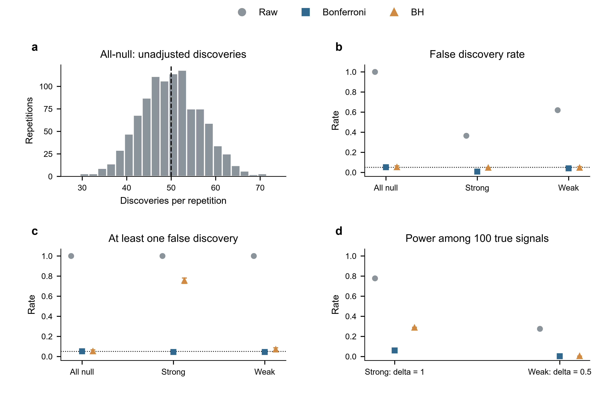
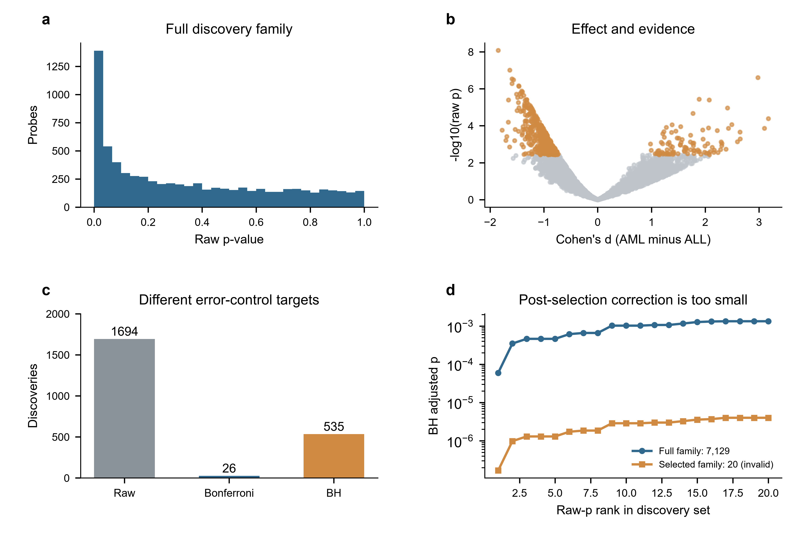
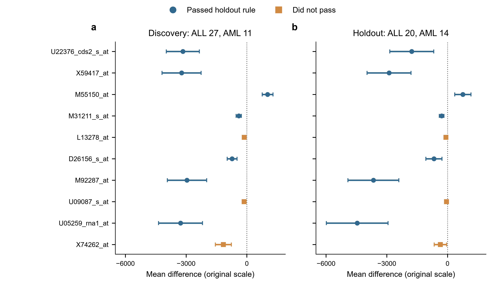

RESEARCH ARTICLE  ·  生物医学数据科学课程论文

从统计显著到可验证发现： 白血病表达数据的多重检验控制

From statistical significance to reproducible candidates: multiple-testing control in leukemia expression data

第 6 讲 · 多重检验校正　|　2026 年 11 月 10 日

## 摘要

高维表达筛选中的显著结果数量不能直接代表真实发现。本文依照课程固定协议，将已知真值的正态模拟与 Golub 白血病表达数据再分析结合，比较原始检验、Bonferroni 和 Benjamini–Hochberg（BH）校正。全零模拟中，1,000 项检验平均产生 49.944 个原始显著结果；校正将其降至约 0.05 个。真实发现集的 7,129 个探针中，原始、Bonferroni 与 BH 显著数分别为 1,694、26 和 535。依据发现集锁定的 10 个候选中，7 个在历史留出样本中满足校正显著且方向一致的判据。结果说明，错误控制、效应估计与预定验证规则提供不同层面的证据；多重校正本身不能确认生物学机制、因果关系或临床有效性。

**关键词：**多重检验；家族错误率；错误发现率；选择偏倚；Welch 检验；白血病

# 1　引言

同时测量数千个表达特征，使研究者能够描述白血病亚型之间的分子差异，也使偶然显著成为必然需要处理的问题。Golub 等人的表达研究为高维癌症分析提供了经典实例 [1]。然而，在大量检验后观察到若干小 p 值，并不足以把对应特征称为疾病机制或临床标志物。

课程提出的“1,000 个基因中有 53 个原始 p 值小于 0.05”是一个假设审阅情境。即使所有零假设均为真，类似数量也完全可能出现。需要回答的不是怎样扩大显著名单，而是实际尝试了多少检验、控制何种错误，以及筛选出的差异能否获得新的支持。

本文将这一问题拆为三个可检验环节：用全零模拟辨别发现数量与错误概率，用部分信号模拟衡量控制错误的检出力代价，再在完整探针家族中筛选并锁定候选后检查留出样本。这是一项按课程协议开展的统计复现与数据再分析，不提出新的多重检验算法。

## 研究对象与核心记号

ALL 指急性淋巴细胞白血病，AML 指急性髓系白血病；两者均为白血病，数据不含健康对照。m 为检验家族大小，R 为全部拒绝数，V 为其中错误拒绝数，S 为正确拒绝数。所有表达差值统一为 Δ = AML − ALL；“探针”不替换为“独立基因”。

---

# 2　错误控制的数学基础

## 2.1　平均约 50 个假阳性并不要求独立

**命题 1（期望与联合风险）。**若 m 个零假设均成立，且各检验在阈值 α 下的假阳性概率恰为 α，则 E(V)=mα；此等式不要求检验独立。若仅有有效性条件 P(pᵢ≤α)≤α，则 E(V)≤mα。

V = Σᵢ I(pᵢ ≤ α)，　E(V) = Σᵢ P(pᵢ ≤ α) = mα。　(1)

**证明。**将每项是否错误拒绝写为指示变量，再使用期望的线性性即可。只有计算“至少一次错误”的乘积形式时才需要独立性；独立且精确校准的全零检验满足下式。

FWER = P(V ≥ 1) = 1 − (1 − α)<super>m</super>。　(2)

因此，m=1,000、α=0.05 时平均假阳性数为 50，FWER 约为 1；m=5,000 时平均数为 250，FWER 更接近 1。相关性会改变计数的波动和联合风险，但不改变上述线性期望推导。一次观察到 53 并不是对“53 个真实基因”的证明。

## 2.2　Bonferroni 与 BH 控制不同的对象

FDP = V / max(R, 1)，　FDR = E(FDP)，　FWER = P(V ≥ 1)。　(3)

Bonferroni adjusted p 为 min(mpᵢ,1)。在单项 p 值有效时，由并集界 P(V≥1)≤Σᵢ∈H₀P(pᵢ≤α/m)≤m₀α/m≤α，可见其 FWER 保证不要求检验独立。代价是阈值严格，可能漏掉真实但较弱的效应。

BH 将 p 值升序排列，取满足 p₍ₖ₎≤kα/m 的最大 k，拒绝前 k 项 [2]。排序后的 BH adjusted p 可写为 min(1,minⱼ≥ᵢ{mp₍ⱼ₎/j})。标准 FDR 保证适用于独立或满足相应正依赖条件的有效检验；并非任意相关性都被自动处理 [3]。

## 2.3　五项检验的手算示例

| 排序 i | 原始 p | Bonferroni | BH 阈值 iα/m | BH adjusted p |

| --- | --- | --- | --- | --- |

| 1 | 0.001 | 0.005 | 0.010 | 0.005 |

| 2 | 0.009 | 0.045 | 0.020 | 0.0225 |

| 3 | 0.020 | 0.100 | 0.030 | 0.0333 |

| 4 | 0.040 | 0.200 | 0.040 | 0.050 |

| 5 | 0.200 | 1.000 | 0.050 | 0.200 |

阈值采用 ≤0.05。Bonferroni 拒绝前 2 项；BH 的最大满足位置 k=4，拒绝前 4 项。第 4 项正好位于边界，仍被拒绝。这是教学 p 值，不是真实探针数据；发现集合不同源于控制目标不同，不意味着某种算法计算错误。

BH adjusted p 与 Storey q-value 不能混称。后者与正错误发现率（pFDR）框架有关，常通过估计真实零假设比例 π₀ 形成自适应估计 [4]；本作业未估计 π₀，也未计算 Storey q-value。两者均不应解读为某个具体结果为假的概率。

---

# 3　模拟：控制错误的检出力代价

每种情境均有 1,000 个独立变量、ALL 27 个观测和 AML 11 个观测，噪声为标准正态，进行双侧等方差 t 检验。种子固定为 42，重复 1,000 次；部分信号情境将前 100 个变量的 AML 均值平移 δ，其余 900 个保持全零。各情境复用相同随机噪声。

图 1. 错误比例、联合风险与检出力不是同一量。（a）全零情境原始显著数的重复分布，虚线为理论均值 50。（b）FDR。（c）FWER。（d）检出力。后三图为重复均值及 ±1.96 个 Monte Carlo 标准误；b、c 的点线为 0.05。Strong 与 Weak 分别为 δ=1 和 0.5。模拟变量不是实测基因。全零 power 无定义，未绘制。

| 情境 | 方法 | 平均 R | 平均 V | FWER | FDR | Power |

| --- | --- | --- | --- | --- | --- | --- |

| 全零 | 原始 | 49.944 | 49.944 | 1.000 | 1.0000 | N/A |

| 全零 | Bonf. | 0.051 | 0.051 | 0.051 | 0.0510 | N/A |

| 全零 | BH | 0.052 | 0.052 | 0.051 | 0.0510 | N/A |

| δ=1.0 | 原始 | 122.523 | 44.799 | 1.000 | 0.3643 | 0.7772 |

| δ=1.0 | Bonf. | 6.001 | 0.044 | 0.044 | 0.0075 | 0.0596 |

| δ=1.0 | BH | 30.094 | 1.445 | 0.754 | 0.0461 | 0.2865 |

| δ=0.5 | 原始 | 72.361 | 44.799 | 1.000 | 0.6187 | 0.2756 |

| δ=0.5 | Bonf. | 0.270 | 0.044 | 0.044 | 0.0393 | 0.0023 |

| δ=0.5 | BH | 0.407 | 0.072 | 0.070 | 0.0453 | 0.0033 |

强信号下，BH 的 FDR 为 0.0461，但 FWER 为 0.754；它降低的是错误发现比例的长期平均，而非保证每轮均无错误。信号减弱后，BH 检出力从 0.2865 降至 0.0034。未显著并不能据此解释为没有真实效应。

---

# 4　完整家族分析与选择偏倚

发现集包含 ALL 27 份、AML 11 份表达样本。全部 7,129 个探针分别进行双侧 Welch t 检验；不按原始 p 值预筛，也不因零或负表达值删除观测。图 2 将显著数量、效应与家族定义放在同一证据链中。

图 2. 原始显著数量需要完整家族与效应背景。（a）7,129 个原始 p 值的分布。（b）各探针的 Cohen d 与 −log₁₀(p)，橙色表示完整家族 BH≤0.05，灰色表示其余探针；d 仅作描述性效应。（c）同一检验家族、同一阈值下的发现数。（d）前 20 个探针的完整家族 BH 与错误的“先选后校正”结果。面板 c 为固定数据计数，无重复误差条；散点无额外滤除。

| 方法（阈值 0.05） | 发现数 | 支持的主张与边界 |

| --- | --- | --- |

| 原始 p | 1,694 | 单项差异证据；尚未控制完整家族错误。 |

| Bonferroni adjusted p | 26 | 在有效单项检验前提下，控制 FWER 的拒绝集合。 |

| BH adjusted p | 535 | 按 BH 规则筛选的探索集合；不能直接计算真实 V 或 power。 |

Bonferroni 的原始 p 阈值为 0.05/7,129=7.01361e-06。以 U22376_cds2_s_at 为例，原始 p=8.39e-09，完整家族 BH=5.98e-05，选前 20 个后重算则为 1.68e-07。后者明显变小，却忽略了在 7,129 项中搜寻的机会，不能支持原研究的错误控制主张。

若 20 个探针确实在查看本次发现数据之前就被独立指定，且研究主张也只涉及该预定家族，则以 m=20 校正可以合理。关键是选择信息的来源和预定范围，而非最终表格有多少行。

---

# 5　候选锁定后，七项通过留出验证

在发现集 BH≤0.05 的探针中，按原始 p 值、探针名依次升序取前 10 项，保存名单与发现方向后才计算留出结果。验证集为 ALL 20 份、AML 14 份样本；通过判据为候选家族内 Bonferroni≤0.05，且表达差值同方向。

图 3. 全部锁定候选的效应及留出表现。点为 AML−ALL 均值差，横线为逐项 95% Welch 置信区间，两面板使用相同横轴尺度。蓝色圆点表示通过预定留出判据；橙色方点表示未通过。逐项区间不是同时区间，也不是选择后校正区间，不能代替候选家族的 Bonferroni 判据。

| 锁定探针 | 验证差值 Δ | 验证 Bonferroni | 同方向 | 通过 |

| --- | --- | --- | --- | --- |

| U22376_cds2_s_at | -1766.73 | 0.0232 | 是 | 是 |

| X59417_at | -2887.31 | 0.000155 | 是 | 是 |

| M55150_at | 758.13 | 0.00902 | 是 | 是 |

| M31211_s_at | -292.33 | 0.000102 | 是 | 是 |

| L13278_at | -77.16 | 0.107 | 是 | 否 |

| D26156_s_at | -671.20 | 0.0197 | 是 | 是 |

| M92287_at | -3661.46 | 5.41e-05 | 是 | 是 |

| U09087_s_at | -49.81 | 0.39 | 是 | 否 |

| U05259_rna1_at | -4460.91 | 5.66e-05 | 是 | 是 |

| X74262_at | -352.24 | 0.26 | 是 | 否 |

10 项候选方向均一致，但 L13278_at、U09087_s_at 和 X74262_at 未达到校正阈值，保留在报告中，不用其他探针替换。7/10 是此固定名单的判据通过比例，既不是已知真值下的检出力，也不能据此认定剩余 3 项就是假阳性。

---

# 6　方法与完整候选证据

## 6.1　数据来源、处理与分析次序

使用课程提供的 OpenML leukemia（ID 1104，version 1）本地 CSV 快照 [5]，共 72 行、7,132 列。其中 sample_id、original_split、diagnosis 为说明字段，其余 7,129 列均纳入发现家族，包括控制探针。保留原处理表达尺度，不取 log，不将非正值视为缺失，不进行结果驱动的过滤或重分组。数据哈希与课程记录一致。

分析按预定次序运行：记录协议，计算 train 全家族结果，演示前 20 项的错误校正，独占创建 10 项锁定名单，最后计算 test 的候选检验。原始文件包含两个划分，因此锁定提供的是可审计的分析次序，而不是前瞻性试验注册或新队列盲法。完整数值函数直接复用课程 Notebook，BH 另与 SciPy 实现交叉核对。

## 6.2　Welch 估计与描述性标准化效应

Δ = x̄AML − x̄ALL，　SE = √(s²AML/nAML + s²ALL/nALL)。　(4)

95% CI = Δ ± t0.975,ν SE，　d = Δ/spooled。　(5)

ν 按 Welch–Satterthwaite 公式计算；合并方差为 [(nAML−1)s²AML+(nALL−1)s²ALL]/(nAML+nALL−2)。Welch 检验允许两组方差不同；Cohen d 使用合并标准差，仅作描述，不改变检验假设。逐项区间不提供家族同时覆盖或筛选后覆盖保证。均值差在原表达尺度上，不能称为表达倍数变化。

## 6.3　一个候选的完整证据记录（C3–C4）

| 证据字段 | U22376_cds2_s_at |

| --- | --- |

| 发现样本量（AML / ALL） | 11 / 27 |

| 发现均值（AML / ALL） | 702.364 / 3863.296 |

| 发现 Δ；逐项 95% CI | -3160.933；[-3977.849, -2344.017] |

| Cohen d；原始 p | -1.8484；8.39e-09 |

| 发现 Bonferroni；BH | 5.98e-05；5.98e-05 |

| 验证样本量（AML / ALL）；Δ | 14 / 20；-1766.729 |

| 验证逐项 95% CI；原始 p | [-2850.721, -682.736]；0.00232 |

| 验证 Bonferroni；方向；判据 | 0.0232；一致；通过 |

该探针在 AML 中的表达均值低于 ALL，完整家族校正及留出结果支持其作为后续验证候选。发现效应绝对值大于验证效应，提示不能只依据筛选阶段的数值评价实际效应；此处未将这一差异进一步宣称为已证明的选择偏倚。

---

# 7　讨论：从错误控制到研究决策

## 7.1　方法选择应由错误代价决定

探索性组学筛选通常需要产生可负担的候选列表。例如在全部探针中寻找值得进一步实验验证的表达差异，可预先选择 FDR 控制，并为后续独立验证保留资源。BH 的较高检出力并不免除机制验证，也不保证每个候选可靠。若误推荐治疗靶点的代价极高，应优先限制至少一次错误的风险，同时提高证据和验证门槛。

确认性临床研究若预先指定 5 个主要疗效终点，可将每项原始 p 阈值设为 0.01，以 Bonferroni 控制整个家族的 FWER。终点、比较方向和模型应事先写入分析计划；更复杂的终点体系还需合适的层级或其他预定策略。本例仅说明控制目标，不构成对某项临床试验设计的建议。

## 7.2　三个概念：定义、例子与错误解释

**p-value。**在指定零假设和统计模型成立时，得到当前统计量或更极端统计量的概率。例如，某预定临床终点的双侧 p=0.03，表示无组间差异模型下如此极端的结果较少见；不能解释为“无效的概率为 3%”，也不能说效应有 97% 概率存在。

**Adjusted p-value。**在指定家族和校正规则中，结果达到拒绝所需的最低名义阈值。例如，5 个预定终点中某项 p=0.009，其 Bonferroni adjusted p=0.045，达到家族 0.05 阈值；这不表示效应较大、临床重要或该结论有 95.5% 概率正确。家族不同，同一原始 p 的调整值可以不同。

**FDR。**重复同一研究流程时，所宣布发现中错误比例的期望，即 E[V/max(R,1)]。例如强信号模拟中 BH 的估计 FDR 为 0.0461；不能解释为每次名单恰有 4.61% 错误，更不能将名单中每项都赋予 95.39% 的真实概率。实际研究通常不知道每项真值，不能从显著数直接算出实际 FDR。

## 7.3　为什么显著之后仍需更多证据

效应大小回答差异有多大，置信区间表达估计的不确定性；两者都不能由 p 值替代。筛选后估计可能偏向较大的观测效应，逐项区间也不自动处理选择。机制证据检验所提出的生物学解释，外部队列与独立实验则检查跨样本和测量条件的可重复性。它们解决的问题不同，不能彼此替代。

本分析的范围受到具体数据条件限制：样本量小且组间不平衡，表达可能偏态并含异常值；有限元数据不足以排除批次、中心或重复患者因素。探针间相关性存在，而本分析没有验证 BH 的依赖条件。保留控制探针有助于固定教学家族，但妨碍把所有显著探针直接解释为疾病相关基因；进入生物研究前仍需重新设计并预注册质控及注释方案。

留出样本来自同一历史研究，不是外部独立队列。未通过验证的候选仍可能存在较弱效应，通过的候选也可能受共同混杂影响。故本文结论止于“存在值得进一步验证的亚型表达差异候选”，不延伸为病因、有效治疗靶点或临床诊断性能。

## 结论

可靠的多重检验报告需同时说明完整检验家族、目标错误率、效应与不确定性，以及不随验证结果改变的候选规则。本文中的七项留出通过结果加强了候选差异的证据，但校正和留出重复均不能自动证明因果关系、临床有效性或所有发现为真。

---

# 补充材料 S1　模拟记录与家族判断

## S1.1　全零实验 A 的完整波动记录

| 方法 | 首次 R | 平均 R | R 标准差 | 5%–95% 分位 | FWER / FDR |

| --- | --- | --- | --- | --- | --- |

| 原始 | 42 | 49.944 | 6.7618 | [39, 61] | 1.000 / 1.000 |

| Bonferroni | 0 | 0.051 | 0.2201 | [0, 1] | 0.051 / 0.051 |

| BH | 0 | 0.052 | 0.2266 | [0, 1] | 0.051 / 0.051 |

全零时全部拒绝均是假发现，V=R。某次若出现一个或更多发现，则该次 FDP=1；没有发现时 FDP=0。因此全零情境 FDR=FWER，但平均发现数量仍是另一量。首次校正后 R=0 不能说明方法绝不出错。模拟估计 0.051 略高于 0.05，其 Monte Carlo 标准误为 0.00696，属于有限重复下的估计波动，不能据此断言理论控制失效。

## S1.2　Monte Carlo 误差与正确汇总

| 情境 | 方法 | FDR 标准误 | FWER 标准误 |

| --- | --- | --- | --- |

| 全零 | 原始 | 0.00000 | 0.00000 |

| 全零 | Bonferroni | 0.00696 | 0.00696 |

| 全零 | BH | 0.00696 | 0.00696 |

| δ=1.0 | 原始 | 0.00113 | 0.00000 |

| δ=1.0 | Bonferroni | 0.00121 | 0.00649 |

| δ=1.0 | BH | 0.00119 | 0.01363 |

| δ=0.5 | 原始 | 0.00170 | 0.00000 |

| δ=0.5 | Bonferroni | 0.00597 | 0.00649 |

| δ=0.5 | BH | 0.00579 | 0.00807 |

FDR 由 1,000 个 FDP 的平均估计，标准误为 FDP 的样本标准差除以 √1000；FWER 同理对 I(V>0) 汇总。不得用平均 V 除以平均 R 替代平均 FDP。表中原始检验的 FWER 标准误为 0，只表示这 1,000 次均发生错误，不证明总体概率精确为 1。

## S1.3　研究决策如何增加检验机会

| 行为 | 预先界定与报告的家族 |

| --- | --- |

| 比较 5 个临床指标 | 若均用于同一确认性主张，纳入这 5 项检验。 |

| 分析 4 个亚组 | 记录全部亚组比较与交互作用；4 个亚组不自动等于全部只有 4 次检验。 |

| 尝试 3 个模型并报最显著者 | 明确同一终点下的模型选择机会，预定主模型或采用考虑选择的策略。 |

| 看完 7,129 个 p 只报前 20 | 报告完整 7,129 项发现家族；不能因最终只呈现 20 行而缩减。 |

**退出卡。**p-value 是零假设模型下的尾部概率，不是真值概率。Adjusted p-value 的解释依赖家族、校正规则及检验有效性。FWER 关注至少一次错误，FDR 关注错误比例的期望。BH adjusted p/q-value 不赋予单项真值概率。候选进入生物学研究仍需质控、注释、效应证据、机制研究和独立验证。

---

# 补充材料 S2　锁定名单与发现证据

以下 10 项均来自发现集，顺序为原始 p 值、探针名依次升序。各探针样本量均为 AML 11、ALL 27。完整 7,129 行结果与全部原始精度数值另存 CSV；下表仅为便于阅读的显示舍入。

| 探针 | 发现 Δ | 逐项 95% CI | Cohen d |

| --- | --- | --- | --- |

| U22376_cds2_s_at | -3160.93 | [-3977.85, -2344.02] | -1.848 |

| X59417_at | -3223.19 | [-4187.52, -2258.85] | -1.636 |

| M55150_at | 1025.98 | [759.13, 1292.82] | 2.977 |

| M31211_s_at | -398.85 | [-527.41, -270.28] | -1.594 |

| L13278_at | -127.38 | [-168.54, -86.22] | -1.565 |

| D26156_s_at | -727.18 | [-969.08, -485.29] | -1.593 |

| M92287_at | -2955.85 | [-3925.75, -1985.94] | -1.467 |

| U09087_s_at | -133.98 | [-178.56, -89.40] | -1.466 |

| U05259_rna1_at | -3274.74 | [-4361.73, -2187.76] | -1.411 |

| X74262_at | -1161.24 | [-1555.88, -766.59] | -1.399 |

| 探针 | 原始 p | Bonferroni | BH adjusted p |

| --- | --- | --- | --- |

| U22376_cds2_s_at | 8.39e-09 | 5.98e-05 | 5.98e-05 |

| X59417_at | 9.82e-08 | 0.0007 | 0.00035 |

| M55150_at | 2.47e-07 | 0.00176 | 0.000464 |

| M31211_s_at | 2.92e-07 | 0.00208 | 0.000464 |

| L13278_at | 3.25e-07 | 0.00232 | 0.000464 |

| D26156_s_at | 5.18e-07 | 0.0037 | 0.000616 |

| M92287_at | 6.83e-07 | 0.00487 | 0.000661 |

| U09087_s_at | 7.41e-07 | 0.00528 | 0.000661 |

| U05259_rna1_at | 1.31e-06 | 0.00937 | 0.00103 |

| X74262_at | 1.49e-06 | 0.0106 | 0.00103 |

## 锁定与验证记录

锁定时间（UTC+08:00）：2026-11-10T10:43:43.098339+08:00。候选数为 10；验证阈值对应原始 p≤0.005，同时要求方向一致。锁定文件使用独占创建，重跑时核对原名单，不覆盖名单。锁定及验证时间记录保存在随附结果目录。

锁定文件：.tmp/multiple-test/student-results/paper-20261110/locked-candidates.csv。下述 SHA-256 校验值用于核对锁定文件在验证前后的一致性：

0ced599ad4474c3f1d2909f4c87bab5f0647182c9d216164eeb88bd12f1f5deb

## “主张—证据—推理—边界”短答

该探针可列为亚型差异候选：发现集校正后显著，留出差值同方向且通过候选家族校正。这增强了差异可重复性的证据，但同一历史研究的留出不能代替外部队列，也不能证明致病机制。

---

# 参考文献与复现说明

1. T. R. Golub et al., Molecular classification of cancer: Class discovery and class prediction by gene expression monitoring. Science **286**, 531–537 (1999). DOI: 10.1126/science.286.5439.531.

2. Y. Benjamini, Y. Hochberg, Controlling the false discovery rate: A practical and powerful approach to multiple testing. J. R. Stat. Soc. B **57**, 289–300 (1995). DOI: 10.1111/j.2517-6161.1995.tb02031.x.

3. Y. Benjamini, D. Yekutieli, The control of the false discovery rate in multiple testing under dependency. Ann. Stat. **29**, 1165–1188 (2001). DOI: 10.1214/aos/1013699998.

4. J. D. Storey, A direct approach to false discovery rates. J. R. Stat. Soc. B **64**, 479–498 (2002). DOI: 10.1111/1467-9868.00346.

5. OpenML, leukemia, dataset 1104, version 1. https://www.openml.org/d/1104. 本文使用课程本地快照；许可字段记录为 Public，不将其改称为 CC BY 或公共领域。

## 数据、代码与环境

原始数据未修改，正式课程 Notebook 未写入执行输出。本次生成的计算表、图、脚本和时间记录保存在根目录 .tmp/multiple-test/student-results/paper-20261110/；提交版论文及便于查阅的副本保存在 output/multiple-testing-paper/。未执行 Git 提交。

计算版本：python 3.12.14, numpy 2.5.4, pandas 2.3.3, scipy 1.18.1。种子 42；每种情境重复 1,000 次。软件版本差异可能引起末位浮点差异，判据按未舍入数值执行。

原始 CSV SHA-256：915bce00295ac470f6bd970a4032730a170a080642a5da53ab0bcb0545156f19

run_analysis.py 复用原课程 Notebook 的数值函数，并将实际挂载目录映射为课程根目录；make_figures.py 从结果 CSV 绘图；build_paper.py 生成论文与可编辑文字源。图 1–3 同时提供 PDF、SVG 和高分辨率 PNG。所有统计图均由数据计算绘制，未使用生成式图像替代观测数据。

## 作业要求对照

| 作业要求 | 本文对应位置 |

| --- | --- |

| 完整运行 C1–C4、候选证据与锁定名单 | 第 4–6 节；补充材料 S2；discovery/replication/locked-candidates.csv |

| p、adjusted p、FDR：定义、例子、错误解释 | 第 7.2 节 |

| 约 50 个原始显著的原因与独立性条件 | 第 2.1 节；补充材料 S1.1 |

| Bonferroni 与 BH 方法比较及手算 | 第 2.2–2.3 节；图 1 |

| 全零与部分真信号模拟、检出力与波动 | 第 3 节；补充材料 S1.1–S1.2 |

| 探索与确认场景、效应/CI/机制/独立验证 | 第 7.1–7.3 节 |

| BH adjusted p 与 Storey q-value 的区别 | 第 2.3 节 |

| 边界、环境版本与可复现记录 | 结论；补充材料；本页 |

## 稿件性质与使用说明

本稿采用研究论文的摘要、分节论证、编号公式、图表、顺序引文及补充材料结构，结合数学期刊常用的单栏版式，服务于中文课程作业；不冒用 Science 标志或出版信息，也不将中文课程复现稿称为已符合正式英文投稿的全部要求。作者姓名、学号与单位未提供，未编造署名。分析代码、文字组织及排版由 AI 辅助完成，提交者应核对结果并依课程规定披露使用方式。